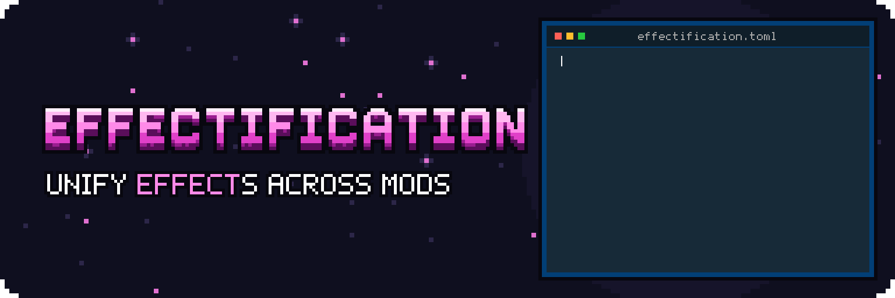
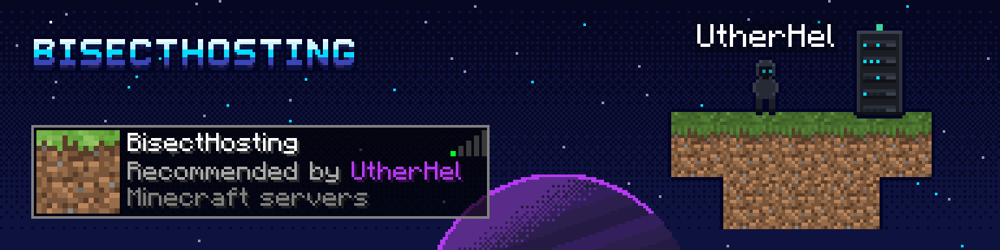
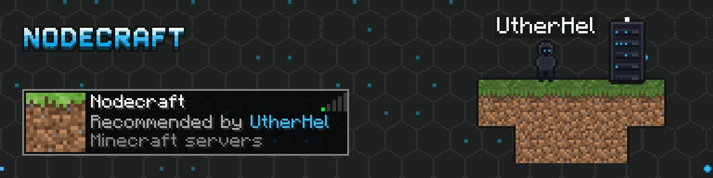
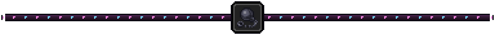

<p align="center">
<a href="https://www.curseforge.com/minecraft/mc-mods/effectification"></a>
<a href="https://modrinth.com/mod/effectification"></a>
<a href="https://github.com/UtherHel/effectification"></a>
</p>

**Bleeding is bleeding.** Three mods add Bleeding, two add Stun, and each checks only its own: an immunity from one does nothing against another, and two of them stack on the same target. Effectification turns an effect of one mod into the matching effect of another, so every mod sees one and the same effect. Minecraft Java 1.20.1 to 26.3: Fabric 1.20.1 and 1.20.4 - 26.3, Forge 1.20.1, NeoForge 1.20.4 - 1.20.6, 1.21.1 - 1.21.5 and 1.21.7 - 26.3. Needs Fzzy Config (and Fabric API on Fabric). Install it on the server and on every client.


- **One effect for all mods.** A mapping applies the target effect wherever the source would be applied, and anything that looks for the source finds the target: immunities, cures and conditions of both mods see the same effect.
- **Wildcards with exceptions.** `*:bleeding* !*:bleeding*_immunity` catches the Bleeding of every mod but leaves the immunities alone.
- **Fallbacks.** Name several targets, separated by commas: the first one that is installed is used.
- **Strength.** `amplifierMultiplier` scales the level on the way (kept within 0-255).
- **Fine control.** Change only the name and icon (`onlyVisualChange`), stop the source mod's own handlers (`unidirectional`), keep another effect's tick running for its visuals (`extraApplyEffectTick`) or silence an effect's tick (`discardEffectTick`).
- **Static or dynamic.** Static mappings swap the effect in the registry at startup, cost nothing while playing and need a restart. Dynamic mappings convert at runtime and apply as soon as you save.
- **An editor in the game,** with every registered effect suggested as you type: Mod Menu on Fabric, the mod list on Forge and NeoForge. The server's mappings are sent to every player.
- **Ready-made mappings** on Forge and NeoForge for Bleeding, Stun, Freeze, Chill, Immolate, Confusion, Knowledge and Sapped, and for the pairs that overlap in Majrusz's Difficulty, Apothic Attributes, Valoria, Relics, Alex's Caves, Alex's Mobs, Mowzie's Mobs, More RPG Classes, Iron's Spells, Goety and Nether Depths Upgrade. Fabric starts empty.


Install it and play: with the built-in mappings a Stun from Goety, Alex's Caves or any other mod is applied as Relics' Stun, and Relics' immunity protects from all of them.

To add a mapping, open the config screen (Mod Menu on Fabric, the mod list on Forge and NeoForge) and add an entry under Dynamic Mappings, or edit `config/effectification/effectification.toml`:

```toml
[[dynamicMappings]]
sourceEffect = "*:stun* !*:stun*_resistance !*:stun*_immunity"
targetEffect = "relics:stun, alexscaves:stunned"
amplifierMultiplier = 1.0
onlyVisualChange = false
unidirectional = false
extraApplyEffectTick = ""
discardEffectTick = ""
```

Every Stun except the resistances and immunities becomes Relics' Stun, or Alex's Caves' Stunned when Relics is not installed.


**Every mapping**, static or dynamic, has the same fields:

| Field | Default | What it does |
| --- | --- | --- |
| `sourceEffect` | - | the effect to replace: an ID or a pattern with `*`, then `!pattern` exceptions after a space |
| `targetEffect` | - | the effect to use instead; several, separated by commas, are fallbacks in order |
| `amplifierMultiplier` | 1.0 | the level is multiplied by it |
| `onlyVisualChange` | false | show the target's name and icon, keep the source's level and behaviour |
| `unidirectional` | false | the source mod's own handlers no longer react to the effect |
| `extraApplyEffectTick` | empty | effects whose tick also runs while the target is active, for their visuals |
| `discardEffectTick` | empty | effects whose tick is blocked; patterns allowed |

`staticMappings` need a restart, `dynamicMappings` apply when saved. `debug.logLevel` (`NONE`, `ERRORS`, `WARNINGS`, `ALL`) controls the log. Changing the server's config takes permission level 2.

**Same idea, for attributes:** [Attributification](https://modrinth.com/mod/attributification).

<!-- hosting:start -->
<!-- Hosting banner: uncomment one line and put your partner link in place of the site address. -->
<!-- [](https://www.bisecthosting.com/) -->
<!-- [](https://www.kinetichosting.com/) -->
<!-- [](https://nodecraft.com/) -->
<!-- hosting:end -->

<!-- promo:start -->
<!-- More from UtherHel: promo cards of other mods go here, two per row, as in the other pages. -->
<!-- promo:end -->


MIT License: free to use, modify, share and include in modpacks, as long as the copyright notice stays with it. See [LICENSE](https://github.com/UtherHel/effectification/blob/main/LICENSE).

Not an official Minecraft product. Not approved by or associated with Mojang or Microsoft.

**More from UtherHel:** [GitHub](https://github.com/UtherHel/effectification) (source and issues)

